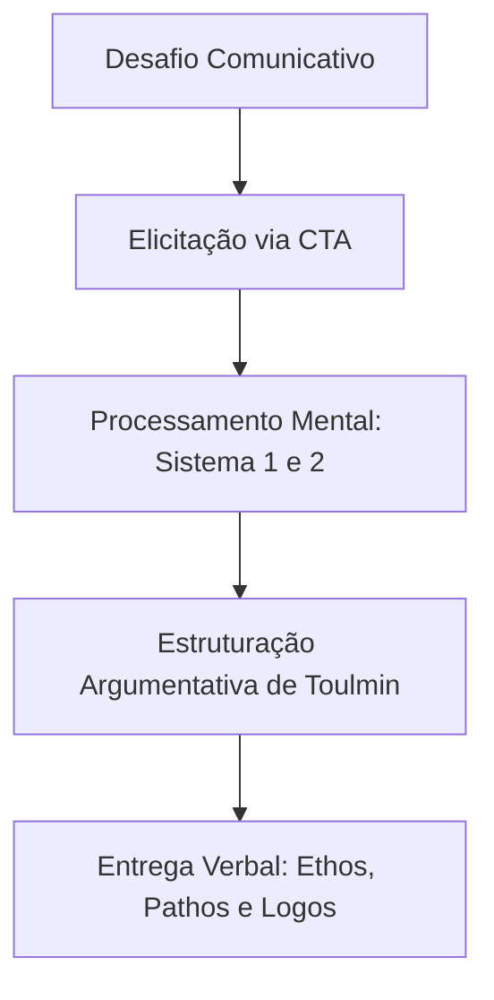

# 🎯 A Arte da Oratória Eficaz & Arquitetura Cognitiva

> **Guia prático e integrado para transformar conhecimento técnico complexo em discursos claros, persuasivos e irrefutáveis.**

---

## 📋 Sumário

- [Visão Geral](#visão-geral)
- [1. Fundamentos da Oratória & Reprogramação Comportamental](#1-fundamentos-da-oratória--reprogramação-comportamental)
- [2. Elicitação de Conhecimento Tácito (SME & CTA)](#2-elicitação-de-conhecimento-tácito-sme--cta)
- [3. Processamento Cognitivo e Raciocínio Científico](#3-processamento-cognitivo-e-raciocínio-científico)
- [4. Formalização Argumentativa (Modelo de Toulmin)](#4-formalização-argumentativa-modelo-de-toulmin)
- [5. Recursos Práticos e Código](#5-recursos-práticos-e-código)
- [Como Usar](#como-usar)
- [Referências](#referências)

---

## Visão Geral

Este repositório conecta a **comunicação verbal de alto impacto** à **arquitetura do pensamento especializado**. É voltado para profissionais, palestrantes e especialistas (*Subject Matter Experts*) que buscam:

1. **Superar bloqueios e travas** de exposição verbal com inteligência emocional e técnicas comportamentais.
2. **Elicitar e estruturar conhecimento tácito** usando protocolos de Análise de Tarefas Cognitivas (*Cognitive Task Analysis - CTA*).
3. **Construir argumentos sólidos e irrefutáveis** através do Modelo de Stephen Toulmin e do raciocínio científico.

---

## 1. Fundamentos da Oratória & Reprogramação Comportamental

### Oratória vs. Falar em Público

| Conceito | Foco Principal | Objetivo Final |
| :--- | :--- | :--- |
| **Falar em Público** | Dicção, postura física, projeção de voz e controle da ansiedade. | Transmitir uma mensagem de forma clara e sem inibição. |
| **Oratória** | Eloquência, estrutura lógica, *storytelling* e empatia. | Persuadir, encantar e transformar a percepção da audiência. |

### Principais Referências

- **Nacionais:** 
  - *Reinaldo Polito:* Técnicas de expressão verbal, postura e superação da inibição.
  - *Prof. Pasquale Cipro Neto:* Precisão gramatical, clareza e riqueza vocabular.
- **Internacionais:** 
  - *Dale Carnegie:* Inteligência relacional, autoconfiança e controle da ansiedade.
  - *Chris Anderson (TED):* Apresentações de alto impacto e sintetização de grandes ideias.
  - *Aristóteles (Retórica Clássica):* A tríade *Ethos* (credibilidade), *Pathos* (conexão emocional) e *Logos* (lógica).

### Pilares C.A.R. e Método ComuniCAR

A comunicação de alto nível é desenvolvida pelo alinhamento de três dimensões:

- **[C] Confiança:** Fortalecimento interno, controle emocional e desinibição.
- **[A] Autoridade:** Projeção cênica, firmeza de voz e posicionamento profissional.
- **[R] Resultado:** Conversão de discursos em acordos, vendas e liderança efetiva.

### Fluxo I.A.M.M.A.R.

Diagnóstico e tratamento prático para superar bloqueios de exposição:

1. **[ I ] Identificar:** Mapear a causa raiz do travamento ou ansiedade.
2. **[ A ] Aceitar:** Reconhecer os pontos de desenvolvimento sem autocrítica excessiva.
3. **[ M ] Motivar:** Definir o propósito e o objetivo da mudança.
4. **[ M ] Método:** Adotar técnicas comprovadas de oratória e linguagem corporal.
5. **[ A ] Aplicar:** Praticar em cenários reais de exposição (reuniões, palestras, vídeos).
6. **[ R ] Reprogramar:** Fixar o novo comportamento através da repetição deliberada.

---

## 2. Elicitação de Conhecimento Tácito (SME & CTA)

### O Paradoxo da Automação

O especialista (*Subject Matter Expert - SME*) desenvolve rotinas mentais automatizadas. Ao tentar explicar seus processos sem métodos estruturados, o especialista costuma omitir **de 12% a 43% dos passos decisórios**, pistas perceptivas e decisões intermediárias.

### Matriz de Metodologias de CTA

| Método | Foco de Investigação | Procedimento | Aplicação Principal |
| :--- | :--- | :--- | :--- |
| **CDM** (*Critical Decision Method*) | Tomada de decisão em incidentes críticos. | Varredura de linha do tempo e identificação de pistas perceptivas. | Medicina de emergência, aviação e gestão de crises. |
| **ACTA** (*Applied Cognitive Task Analysis*) | Demandas cognitivas de tarefas específicas. | Tabela de exigências mentais e cenários de simulação. | Design instrucional e treinamento técnico. |
| **GDTA** (*Goal-Directed Task Analysis*) | Consciência situacional (*Situation Awareness*). | Decomposição hierárquica de metas, submetas e decisões. | Painéis de controle industrial e sistemas complexos. |
| **CPP** (*Concepts, Processes, Procedures*) | Sequenciamento conceitual e operacional. | Mapeamento direto entre raciocínio técnico e instrução. | Capacitação corporativa e e-learning. |

---

## 3. Processamento Cognitivo e Raciocínio Científico

### Método Hipotético-Dedutivo

A resolução de problemas por especialistas segue o ciclo rigoroso do método científico:

`Anomalia` ➔ `Formulação de Hipóteses` ➔ `Dedução de Consequências` ➔ `Testagem e Falsificação`

- **Falsificabilidade:** Discursos e teses robustas resistem a tentativas explícitas de refutação e testes de estresse.

### Teoria do Duplo Processo (Sistema 1 vs. Sistema 2)

- **Sistema 1 (Intuitivo):** Rápido, automático e focado no recognition de padrões da memória de longo prazo.
- **Sistema 2 (Analítico):** Lento, deliberado e consciente, acionado diante de anomalias, dados ambíguos ou cenários de alto risco.

---

## 4. Formalização Argumentativa (Modelo de Toulmin)

Para estruturar ideias de forma **irrefutável**, o modelo de Stephen Toulmin utiliza 6 componentes essenciais:

```
[ Dados / Grounds ] ─────────────────────────► [ Alegação / Claim ]
         │                                            ▲
         │                                            │
   ( Garantia / Warrant )                     ( Qualificador Modal )
         │                                            │
         ▼                                            │
  [ Apoio / Backing ]                       [ Refutação / Rebuttal ]
```

1. **Alegação (*Claim*):** Tese, conclusão ou recomendação central.
2. **Dados (*Grounds*):** Fatos, estatísticas e evidências concretas.
3. **Garantia (*Warrant*):** Princípio lógico que autoriza a passagem dos Dados para a Alegação.
4. **Apoio (*Backing*):** Fundamentação teórica, normativa ou bibliográfica da garantia.
5. **Qualificador Modal (*Qualifier*):** Grau de certeza da afirmação (*ex: "Com elevada probabilidade"*).
6. **Refutação (*Rebuttal*):** Mapeamento prévio de exceções onde a alegação perde a validade.

---

## 5. Recursos Práticos e Código

### Diagrama de Fluxo Cognitivo (Mermaid)



### Template JSON do Argumento

```json
{
  "argumento": {
    "alegacao": "Devemos adotar a arquitetura de microsserviços.",
    "dados": "O sistema atual ficou indisponível por 14 horas no último trimestre.",
    "garantia": "Sistemas distribuídos isolam falhas e garantem escalabilidade.",
    "apoio": "Boas práticas documentadas na engenharia de software.",
    "qualificador": "Em cenários de tráfego elevado,",
    "refutacao": "A menos que a equipe não receba treinamento prévio em contêineres."
  }
}
```

### Validador de Argumentos em Python (`validador_toulmin.py`)

```python
#!/usr/bin/env python3
from typing import Dict, List, Tuple

class ValidadorToulmin:
    def __init__(self, argumento: Dict[str, str]):
        self.argumento = argumento
        self.obrigatorios = ["alegacao", "dados", "garantia"]
        self.opcionais = ["apoio", "qualificador", "refutacao"]

    def validar(self) -> Tuple[bool, List[str]]:
        relatorio = []
        valido = True

        for item in self.obrigatorios:
            if not self.argumento.get(item, "").strip():
                relatorio.append(f"❌ Ausente obrigatório: {item.upper()}")
                valido = False
            else:
                relatorio.append(f"✅ Presente obrigatório: {item.upper()}")

        for item in self.opcionais:
            if not self.argumento.get(item, "").strip():
                relatorio.append(f"⚠️ Recomendado adicionar: {item.upper()}")
            else:
                relatorio.append(f"✅ Presente opcional: {item.upper()}")

        return valido, relatorio

if __name__ == "__main__":
    exemplo_argumento = {
        "alegacao": "A equipe deve adotar o método ACTA no levantamento de requisitos.",
        "dados": "Entrevistas convencionais omitem até 43% das decisões críticas de especialistas.",
        "garantia": "O método ACTA mapeia explicitamente as exigências cognitivas e pistas perceptivas.",
        "apoio": "Estudos de CTA publicados na literatura especializada.",
        "qualificador": "Com alta probabilidade,",
        "refutacao": "A menos que o prazo do projeto seja inferior a 24 horas."
    }

    validador = ValidadorToulmin(exemplo_argumento)
    sucesso, logs = validador.validar()

    print("=== RELATÓRIO DE INTEGRIDADE ARGUMENTATIVA ===")
    for log in logs:
        print(log)
    print(f"\nResultado: {'PRONTO PARA APRESENTAÇÃO' if sucesso else 'NECESSITA REVISÃO'}")
```

---

## Como Usar

1. **Clonar o Repositório:**
   ```bash
   git clone git@github.com:usuario/oratoria-arquitetura-cognitiva.git
   cd oratoria-arquitetura-cognitiva
   ```

2. **Executar o Validador de Argumentos:**
   ```bash
   python3 validador_toulmin.py
   ```

3. **Aplicação Prática:**
   - Preencha a estrutura JSON de Toulmin ao planejar reuniões ou palestras importantes.
   - Aplique a matriz de CTA ao entrevistar especialistas para documentação técnica.

---

## Referências

- **Anderson, Chris.** *TED Talks: O guia oficial do TED para falar em público*.
- **Aristóteles.** *A Retórica*.
- **Carnegie, Dale.** *Como Falar em Público e Influenciar Pessoas*.
- **Crandall, B., Klein, G., & Hoffman, R. R.** *Working Minds: A Practitioner's Guide to Cognitive Task Analysis*. MIT Press.
- **Polito, Reinaldo.** *Como Falar Corretamente e Sem Inibição*.
- **Toulmin, Stephen E.** *The Uses of Argument*. Cambridge University Press.
