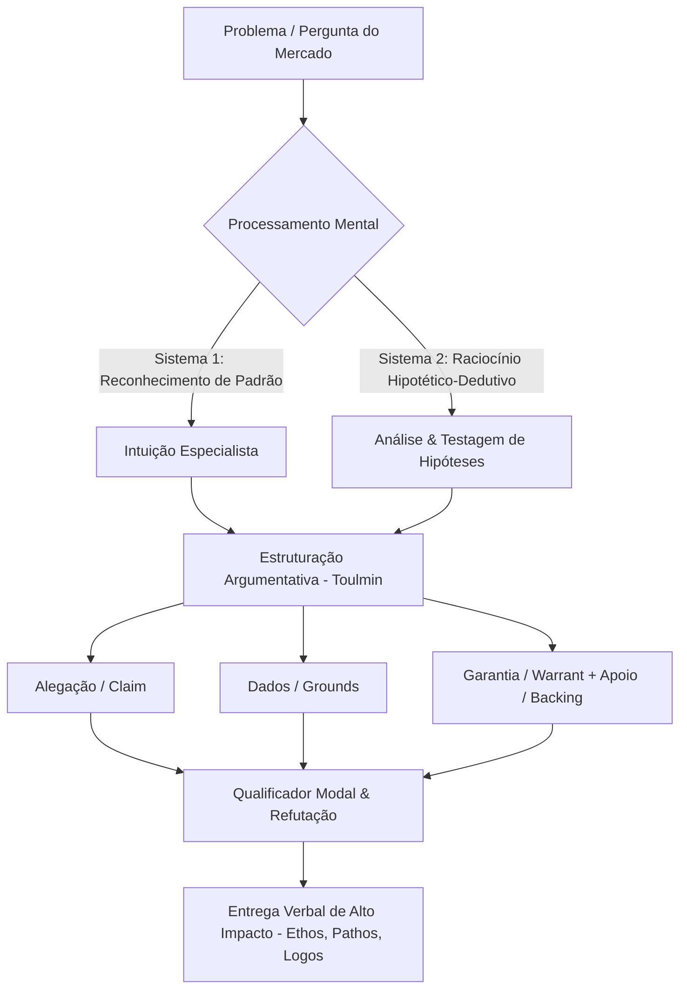

# 🎯 A Arte da Oratória Eficaz e Arquitetura Cognitiva da Especialização

> **Repositório Integrado de Conhecimento:** Estrutura completa reunindo a ciência da comunicação verbal, reprogramação comportamental, elicitação de conhecimento tácito, raciocínio científico e formalização argumentativa.

---

## 📋 Tabela de Conteúdos
1. [Visão Geral e Objetivos](#-visão-geral-e-objetivos)
2. [Fundamentos da Oratória e Comunicação Persuasiva](#-fundamentos-da-oratória-e-comunicação-persuasiva)
   - [Oratória vs. Falar em Público](#oratória-vs-falar-em-público)
   - [Matriz de Autores e Abordagens](#matriz-de-autores-e-abordagens)
3. [Desenvolvimento Comportamental e o Método ComuniCAR](#-desenvolvimento-comportamental-e-o-método-comunicar)
   - [Pilares C.A.R.](#pilares-car-confiança-autoridade-resultado)
   - [Fluxo I.A.M.M.A.R. (Diagnóstico e Tratamento)](#fluxo-iammar)
4. [Arquitetura Cognitiva do Especialista (SME) e Elicitação de Conhecimento Tácito](#-arquitetura-cognitiva-do-especialista-sme-e-elicitação-de-conhecimento-tácito)
   - [Ontologia do SME e o Paradoxo da Automação](#ontologia-do-sme-e-o-paradoxo-da-automação)
   - [Metodologias de CTA (CDM, ACTA, GDTA, CPP)](#metodologias-de-cognitive-task-analysis-cta)
5. [Modelos de Raciocínio Científico e Processamento Mental](#-modelos-de-raciocínio-científico-e-processamento-mental)
   - [O Método Hipotético-Dedutivo e Falsificabilidade](#método-hipotético-dedutivo)
   - [Teoria do Duplo Processo (Sistema 1 vs. Sistema 2)](#teoria-do-duplo-processo-e-continuum-cognitivo)
   - [Pensamento Sistêmico e Avaliação de Trade-Offs (ATAM)](#pensamento-sistêmico-e-atam)
6. [Formalização Argumentativa: O Modelo de Stephen Toulmin](#-formalização-argumentativa-o-modelo-de-stephen-toulmin)
   - [Os 6 Componentes Fundamentais](#os-6-componentes-do-modelo-de-toulmin)
   - [Tipos de Alegações (*Claims*)](#tipos-de-alegações)
7. [Blocos de Código e Frameworks Práticos](#-blocos-de-código-e-frameworks-práticos)
   - [Diagrama Mermaid de Fluxo Cognitivo-Argumentativo](#diagrama-mermaid)
   - [Template JSON de Toulmin](#template-json-de-toulmin)
   - [Script Python de Validação de Argumento](#script-python-de-validação)
8. [Referências das Fontes](#-referências-das-fontes)

---

## 🎯 Visão Geral e Objetivos

Este repositório estabelece uma ponte entre a **prática da expressão verbal de alto impacto** e a **estrutura cognitiva que fundamenta o pensamento especializado**. O objetivo principal é fornecer diretrizes teóricas e práticas para que profissionais e especialistas transformem conhecimentos complexos em discursos claros, persuasivos, logicamente estruturados e irrefutáveis.

---

## 🗣️ Fundamentos da Oratória e Comunicação Persuasiva

### Oratória vs. Falar em Público

A comunicação verbal divide-se em duas dimensões complementares:

| Conceito | O que significa? | Foco Principal |
| :--- | :--- | :--- |
| **Falar em Público** | Ação física e social de se comunicar perante uma audiência. | Superar o medo imediato, projetar a voz, manter postura física e transmitir uma mensagem de forma clara. |
| **Oratória** | A arte e a ciência técnica de falar com eloquência e persuasão. | Estruturar argumentos irrefutáveis, encantar a audiência, dominar a linguagem corporal e causar transformação perceptiva. |

### Matriz de Autores e Abordagens

A literatura de referência divide-se entre mestres nacionais e internacionais:

#### 🇧🇷 Principais Autores Nacionais
- **Reinaldo Polito:** Pioneiro no ensino da expressão verbal no Brasil. Focado em técnicas práticas de superação da inibição, impostação vocal, postura e estruturação de discursos corporativos e acadêmicos.
- **Professor Pasquale Cipro Neto:** Foco na clareza gramatical, expansão vocabular e precisão idiomática como pilares da credibilidade e persuasão.

#### 🌎 Principais Autores Internacionais
- **Dale Carnegie:** Foco em inteligência relacional, desenvolvimento pessoal, autoconfiança, controle da ansiedade e empatia com o público (*Como Falar em Público e Influenciar Pessoas*).
- **Chris Anderson (TED):** Foco em oratória contemporânea, apresentações de alto impacto, *storytelling* e sintetização de grandes ideias em discursos curtos.
- **Aristóteles (Retórica Clássica):** A tríade fundamental da persuasão:
  - **Ethos:** Construção da autoridade, credibilidade e caráter percebido do orador.
  - **Pathos:** Conexão emocional, sintonia afetiva e leitura das necessidades da audiência.
  - **Logos:** Estrutura lógica, coerência argumentativa e solidez das evidências.

---

## 🚀 Desenvolvimento Comportamental e o Método ComuniCAR

### Pilares C.A.R. (Confiança, Autoridade, Resultado)

O desenvolvimento da comunicação de alto nível não ocorre por memorização de frases, mas pela reprogramação comportamental interna:

```
[ C ] CONFIANÇA  (Mentalidade Interna & Desinibição)
       │
       ▼
[ A ] AUTORIDADE (Posicionamento Externo & Presença)
       │
       ▼
[ R ] RESULTADO  (Faturamento, Contratos & Impacto Real)
```

1. **Confiança (C):** A base interna. Restauração da identidade, inteligência emocional e superação das travas que bloqueiam a expressão.
2. **Autoridade (A):** A projeção externa. Alinhamento entre competência real e percepção de mercado, garantindo postura firme e presença cênica.
3. **Resultado (R):** A conversão tangível. Transformação do discurso em fechamento de acordos, liderança efetiva e avanço profissional.

### Fluxo I.A.M.M.A.R.

O fluxo de transformação divide-se rigorosamente em blocos de **Diagnóstico** e **Tratamento**:

```mermaid
graph TD
    subgraph Diagnóstico (IAM)
        I[1. Identificar a Trava] --> A[2. Aceitar a Origem]
        A --> M1[3. Motivar-se à Mudança]
    end
    subgraph Tratamento (MAR)
        M1 --> M2[4. Método de Reprogramação]
        M2 --> A2[5. Aplicar no Cenário Real]
        A2 --> R[6. Reprogramar Neurolinguisticamente]
    end
```

---

## 🧠 Arquitetura Cognitiva do Especialista (SME) e Elicitação de Conhecimento Tácito

### Ontologia do SME e o Paradoxo da Automação

O **Subject Matter Expert (SME)** é caracterizado pelo acúmulo de conhecimento profundo e vertical em um domínio específico. Contudo, a aquisição de maestria gera o **Paradoxo da Automação**:
- Com a prática continuada, rotinas decisórias migram da memória de trabalho consciente para automatismos de longo prazo.
- Ao tentar explicar seus processos sem métodos estruturados, especialistas **omitem voluntária ou involuntariamente entre 12% e 43% dos passos críticos, pistas perceptivas e decisões intermediárias**.

### Metodologias de Cognitive Task Analysis (CTA)

Para extrair e formalizar esse conhecimento tácito sem perdas, utilizam-se os protocolos de CTA:

| Metodologia | Foco de Investigação | Procedimento Operacional | Aplicação Principal |
| :--- | :--- | :--- | :--- |
| **Critical Decision Method (CDM)** | Tomada de decisão em incidentes críticos e não-rotineiros. | Recontagem cronológica, varreduras de linha do tempo e identificação de pontos de decisão e pistas perceptivas. | Medicina de emergência, aviação, gestão de crises e operações sob pressão. |
| **Applied Cognitive Task Analysis (ACTA)** | Demandas mentais e habilidades cognitivas específicas de tarefas. | Aplicação de Diagrama de Tarefas, Tabela de Exigências Cognitivas e Amostras de Simulação. | Design instrucional ágil, engenharia de interfaces e treinamento. |
| **Goal-Directed Task Analysis (GDTA)** | Conscientização situacional (*Situation Awareness*) e estruturas de metas. | Decomposição hierárquica em Metas, Submetas e Decisões associadas. | Painéis de controle industrial, arquitetura de sistemas e software. |
| **Concepts, Processes, Procedures (CPP/GEL)** | Sequenciamento de subtarefas e cenários de resolução. | Mapeamento direto entre elicitação cognitiva e design instrucional estruturado. | Educação e capacitação técnica avançada. |

---

## 🔬 Modelos de Raciocínio Científico e Processamento Mental

### Método Hipotético-Dedutivo

A resolução de problemas complexos por especialistas segue o ciclo rigoroso do método hipotético-dedutivo (Popper; Kalinowski & Pelakh):

1. **Observação de Anomalia / Problema:** Identificação de uma discrepância no sistema sob análise.
2. **Formulação de Hipóteses:** Conjecturas explicativas provisórias baseadas no conhecimento prévio.
3. **Dedução de Consequências:** Determinação das predições lógicas observáveis caso a hipótese seja verdadeira.
4. **Testagem Empírica / Falsificação:** Tentativa deliberada de refutar a hipótese através de testes rigorosos, evitando a *falácia formal da afirmação do consequente*.

### Teoria do Duplo Processo e Continuum Cognitivo

O cérebro do especialista navega dinamicamente entre dois sistemas mentais:

- **Sistema 1 (Autônomo / Intuitivo):** Rápido, automático, de baixo custo cognitivo. Opera por reconhecimento de padrões acumulados na memória de longo prazo.
- **Sistema 2 (Deliberativo / Analítico):** Lento, consciente, de alto consumo da memória de trabalho. Acionado diante de dados ambíguos, anomalias ou cenários de alto risco para conduzir simulações hipotéticas.

### Pensamento Sistêmico e ATAM

A tomada de decisão técnica não analisa elementos isolados, mas redes interconectadas de causa e efeito. No **Architecture Tradeoff Analysis Method (ATAM)**, especialistas avaliam sistemas mapeando:
- **Pontos de Sensibilidade:** Parâmetros arquiteturais que afetam diretamente atributos de qualidade.
- **Trade-Offs:** Decisões que beneficiam um atributo (ex: velocidade) em prejuízo de outro (ex: segurança).
- **Riscos Não-Mitigados:** Cenários de incerteza que exigem planos de reserva.

---

## 🏛️ Formalização Argumentativa: O Modelo de Stephen Toulmin

A transformação do raciocínio analítico em um discurso irrefutável exige a estrutura formal proposta pelo filósofo Stephen Toulmin.

### Os 6 Componentes do Modelo de Toulmin

```
  [ Dados / Grounds ] ─────────────────────────► [ Alegação / Claim ]
           │                                            ▲
           │                                            │
     ( Garantia / Warrant )                     ( Qualificador )
           │                                            │
           ▼                                            │
    [ Apoio / Backing ]                       [ Refutação / Rebuttal ]
```

1. **Alegação (*Claim*):** A tese, conclusão ou recomendação central formulada pelo orador.
2. **Dados (*Grounds / Data*):** Fatos empíricos, estatísticas, medições e evidências concretas.
3. **Garantia (*Warrant*):** Princípio, lei científica ou regra de domínio que autoriza a passagem lógica dos Dados para a Alegação.
4. **Apoio (*Backing*):** Arcabouço teórico, normas ou literatura técnica que legitimam a Garantia.
5. **Qualificador Modal (*Qualifier*):** Termo que delimita o grau de certeza ou probabilidade da afirmação (ex: *"Com elevada probabilidade"*, *"Geralmente"*).
6. **Refutação / Reserva (*Rebuttal*):** Mapeamento prévio das exceções e condições de contorno onde a alegação perde a validade.

### Tipos de Alegações

- **Alegação de Fato:** Afirmações sobre realidades verificáveis e dados objetivos.
- **Alegação de Valor:** Julgamentos qualitativos e éticos respaldados por valores compartilhados.
- **Alegação de Política:** Propostas de mudança de diretrizes, procedimentos ou ações operacionais.
- **Alegação de Definição:** Delimitação conceitual precisa de termos e fenômenos.

---

## 💻 Blocos de Código e Frameworks Práticos

### Diagrama Mermaid



### Template JSON de Toulmin

```json
{
  "argumento_toulmin": {
    "alegacao_claim": "A infraestrutura corporativa deve adotar uma arquitetura desacoplada baseada em microsserviços.",
    "dados_grounds": "O sistema monolítico atual apresentou latência média de 1200ms e queda durante o pico de demanda no Q3.",
    "garantia_warrant": "Sistemas desacoplados distribuem a carga de processamento de forma independente e evitam gargalos centralizados.",
    "apoio_backing": "Benchmarks da indústria de engenharia de software e princípios teóricos de sistemas distribuídos (SEI/CMU).",
    "qualificador_qualifier": "Com altíssima probabilidade, sob condições normais de tráfego esperadas,",
    "refutacao_rebuttal": "A menos que a equipe de engenharia não receba treinamento prévio na governança de contêineres e orquestração."
  }
}
```

### Script Python de Validação

```python
#!/usr/bin/env python3
"""
Validador de Integridade Argumentativa de Toulmin
Verifica se uma estrutura de discurso contém os elementos indispensáveis para a irrefutabilidade.
"""

from typing import Dict, List, Tuple

class ToulminArgumentValidator:
    def __init__(self, argument: Dict[str, str]):
        self.argument = argument
        self.required_keys = ["claim", "grounds", "warrant"]
        self.nuance_keys = ["backing", "qualifier", "rebuttal"]

    def validate(self) -> Tuple[bool, List[str]]:
        logs = []
        is_valid = True

        # Verificar pilares obrigatórios
        for key in self.required_keys:
            if not self.argument.get(key) or len(self.argument[key].strip()) == 0:
                logs.append(f"❌ ERRO CRÍTICO: O componente obrigatório '{key.upper()}' está ausente.")
                is_valid = False
            else:
                logs.append(f"✅ OK: Componente '{key.upper()}' verificado.")

        # Verificar componentes de nuance e ethos
        for key in self.nuance_keys:
            if not self.argument.get(key) or len(self.argument[key].strip()) == 0:
                logs.append(f"⚠️ AVISO: Componente de nuance '{key.upper()}' ausente. Recomenda-se adicionar para fortificar o Ethos.")
            else:
                logs.append(f"✅ OK: Componente de nuance '{key.upper()}' verificado.")

        return is_valid, logs

if __name__ == "__main__":
    exemplo_discurso = {
        "claim": "Devemos implementar a metodologia ACTA no design instrucional da empresa.",
        "grounds": "A elicitação não estruturada atual omite 30% das decisões críticas dos especialistas.",
        "warrant": "A ACTA extrai especificamente as exigências cognitivas e critérios de decisão inconscientes.",
        "backing": "Meta-análises comprovam tamanho de efeito Hedges g = 0.871 para treinamentos baseados em CTA.",
        "qualifier": "Em grande parte das aplicações operacionais,",
        "rebuttal": "A menos que o prazo de execução da análise seja inferior a 48 horas."
    }

    validator = ToulminArgumentValidator(exemplo_discurso)
    valido, relatorio = validator.validate()

    print("=== RELATÓRIO DE INTEGRIDADE ARGUMENTATIVA ===")
    for item in relatorio:
        print(item)
    print(f"\nStatus Final: {'APROVADO PARA APRESENTAÇÃO' if valido else 'NECESSITA REVISÃO'}")
```

---

## 📚 Referências das Fontes

- **Aristóteles.** *A Retórica*.
- **Anderson, Chris.** *TED Talks: O guia oficial do TED para falar em público*.
- **Carnegie, Dale.** *Como Falar em Público e Influenciar Pessoas no Mundo dos Negócios*.
- **Cipro Neto, Pasquale.** Ensaios e intervenções sobre gramática e clareza no uso da Língua Portuguesa.
- **Clark, R. E., Feldon, D. F., et al.** *Cognitive Task Analysis for Expert-Based Instruction*.
- **Hoffman, R. R., Crandall, B., & Klein, G.** *Working Minds: A Practitioner's Guide to Cognitive Task Analysis*. MIT Press.
- **Kalinowski, S. T., & Pelakh, A. (2024).** *A hypothetico-deductive theory of science and learning*. Journal of Research in Science Teaching.
- **Koh, D. S. M., Koedinger, K. R., Rosé, C. P., & Feldon, D. F. (2015).** *Expertise in Cognitive Task Analysis Interviews*. Cognitive Science Society.
- **Polito, Reinaldo.** *Como Falar Corretamente e Sem Inibição*; *Oratória Para Quem Tem Pressa*.
- **Reginatto, Guilherme.** *Mentoria ComuniCAR: Método e Reprogramação Comportamental para Expressão de Autoridade*.
- **Toulmin, Stephen E.** *The Uses of Argument*. Cambridge University Press.
